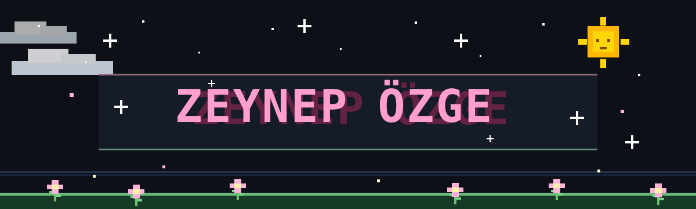

  <!-- MAGICAL PIXEL HEADER -->
  

  <!-- PIXEL BEES & FLOWERS -->
  

    
    
    
  

  <!-- TYPING ANIMATION -->
  

   

  <!-- ANIMATED PIXEL GARDEN -->
  

   

  <!-- SOCIAL LINKS -->
  

    
    
  

---

## 🌿 Hakkımda

- ✨ **Konum:** İstanbul, Türkiye 📍
- 🌸 **Odak:** Kubernetes, Clean Architecture & AI
- 🐛 **Şu an:** Kubernetes Sistemlerinde Yapay Zeka Destekli Self-Healing Projesi üzerinde çalışıyorum.
- 🐝 **Öğrenmeye devam:** DevOps Engineering

---

  <h2>🎨 Araç Kutusu & Yetenekler</h2>

  

---

  <!-- TOP LANGUAGES -->
  <picture>
    <source
      media="(prefers-color-scheme: dark)"
      srcset="https://github-readme-stats.vercel.app/api/top-langs/?username=zeynep0zge&layout=compact&hide_border=true&bg_color=00000000&title_color=F7A6C4&text_color=E2E8F0"
    />
    
  </picture>

   

---
  </picture>

  
🌸 Keep growing, keep creating. 🌸

